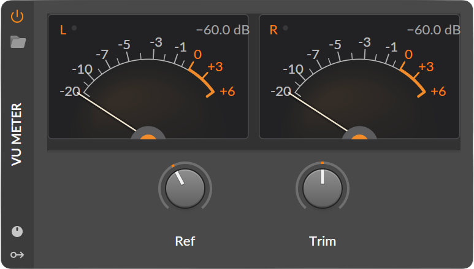

# Cimm's Bitwig devices

Native Bitwig Studio devices by Cimm, made with polarity's
[Bitwig device blueprint](https://github.com/polarity/bitwig-devices-blueprint).

## Devices

| Device | Type | Description | Download |
|---|---|---|---|
| [VU Meter](devices/cimm-vu) | Audio FX | Stereo needle VU meter: VU, PPM and RMS ballistics, L/R or M/S, peak hold, clip LED. Settings in the Inspector and a live mini view in the mixer. | [Bitwig 6.1.7](https://github.com/cimmmusic/bitwig-devices/releases/download/downloads/VU-Meter-macos-6.1.7.zip) · [Bitwig 6.1.4](https://github.com/cimmmusic/bitwig-devices/releases/download/downloads/VU-Meter-macos-6.1.4.zip) |

Builds are for macOS (not yet tested on Windows). The finished device files are also in [Bitwig-6.1.7](Bitwig-6.1.7) and [Bitwig-6.1.4](Bitwig-6.1.4), where Patchbay Launcher finds them: add `cimmmusic/bitwig-devices` as a Devices source. All downloads: [Releases](https://github.com/cimmmusic/bitwig-devices/releases/tag/downloads).

Mods for Bitwig's interface live in [bitwig-mods](https://github.com/cimmmusic/bitwig-mods).

---

## About the blueprint

A small, source-built Bitwig Studio Audio FX for people and coding agents.
**Blueprint Gain** combines a native gain knob, original stereo DSP in Nitro,
and a SkSL output display. The reference target is **Bitwig Studio 6.1.3 on
Windows x64**.

1. [Set up and run the offline preflight](docs/BUILD.md).
2. [Adapt the DSP, graph or shader panel](docs/AUTHORING.md).
3. [Load the verified artifact through Patchbay and test it](docs/BITWIG-TEST.md).

Point a coding agent at [AGENTS.md](AGENTS.md). Builds use the compiler JARs
from your own Bitwig installation.
