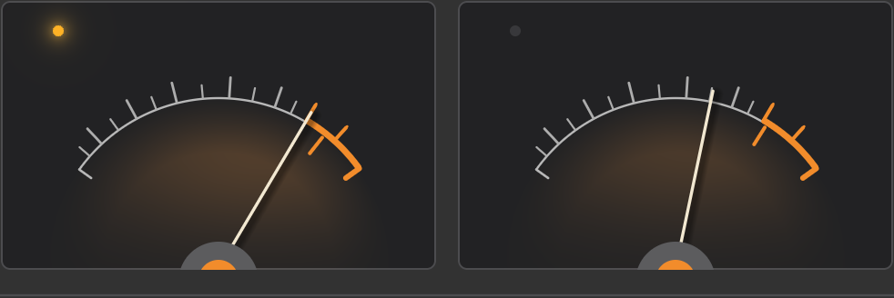
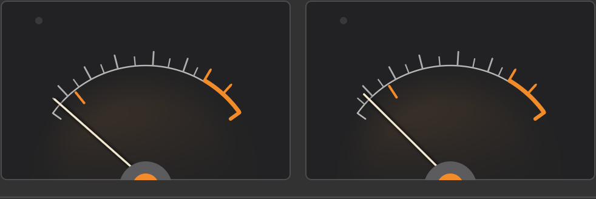
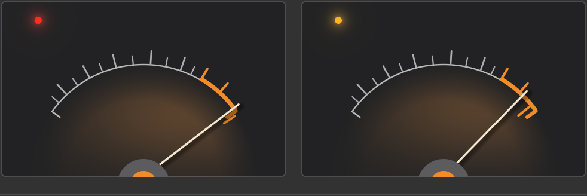

# VU Meter

A native stereo needle VU meter for Bitwig Studio, in the spirit of Klanghelm VUMT.
Audio passes through unchanged.

## Features

- VU, PPM and RMS ballistics
- L/R or M/S metering
- Adjustable needle overshoot
- Peak hold with readouts
- Smart clip LED

| Quiet | Hot |
| --- | --- |
|  |  |

## Build

Built against Bitwig Studio 6.1.7 on macOS (Apple silicon). Build and load it the
same way as the blueprint device: see [BUILD.md](../../docs/BUILD.md) and
[BITWIG-TEST.md](../../docs/BITWIG-TEST.md).

Opening a project with VU Meter in a Bitwig that doesn't have it installed can crash
Bitwig. Use [`scripts/share_safe_copy.py`](../../scripts/share_safe_copy.py) to make
a copy of a project without it, or install the
[Missing Device Guard](https://github.com/cimmmusic/bitwig-mods/tree/perf/missing-device-guard) mod.
